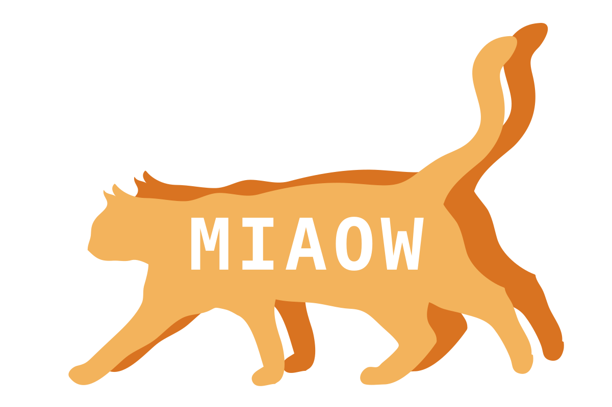

# MIAOW: Model-Independent Actor Orchestration Workflows for Scientific Computing

[](https://github.com/uofs-simlab/miaow-framework/actions/workflows/ci.yml)

<p align="center">
  
</p>

Managing concurrent numerical simulation tasks with dynamic workloads and heterogeneous hardware can feel like herding cats. **MIAOW** embraces that reality by using actor-based asynchronous orchestration so tasks run when they are ready, maximizing utilization across available resources.

MIAOW targets the [C++17 standard](https://en.cppreference.com/w/cpp/17.html), uses the [C++ Actor Framework (CAF)](https://www.actor-framework.org/), and integrates with the [Basic Model Interface (BMI)](https://bmi.csdms.io/en/stable/).


## Quick start

From the repository root, using [CMake](https://cmake.org/) (requires C++ and Fortran compilers):

```sh
cmake -S . -B build
cmake --build build
```

Run each example from its own `examples/<example_name>` directory:

```sh
cd examples/00_hello
./miaow_hello
cd ../01_heat
./miaow_heat
cd ../02_soil_freeze_thaw
./miaow_soil_freeze_thaw --output_root ./output --max_workers 2
cd ../03_dynamic_bmi
./miaow_dynamic_bmi --output_root ./output --max_workers 2
cd ../04_noah_owp
./miaow_noah_owp --realization realization.json
```

## Orchestration model

MIAOW executes simulation workflows with the following actor hierarchy:

```text
Runtime (shared for process lifetime)
└─ orchestrator_actor (shared, one per Runtime)
   └─ job_actor (one per submitted job)
      └─ simulation_unit_actor (many per job, up to max_workers)
```

Typical workflow:

1. Caller invokes `Runtime::submit_job(tasks)`.
2. Runtime assigns a `job_id` and sends `(job_id, tasks)` to `orchestrator_actor`.
3. `orchestrator_actor` spawns one `job_actor` for that job.
4. `job_actor` greedily dispatches tasks to available `simulation_unit_actor` workers.
5. Completed task results are aggregated into one `JobResult`.
6. Runtime fulfils the caller's `JobHandle` future.

Note that multiple
`submit_job(...)` calls can be running concurrently.

## Scheduling behaviour

Each `job_actor` maintains:

- a pending-task cursor (`next_task_to_dispatch_`)
- a queue of idle workers (`available_workers_`)

When a worker finishes, it is immediately returned to the idle queue and the
next pending task is dispatched. This greedy policy keeps workers occupied while
remaining simple and predictable.

## Public API summary

Key types in `include/miaow.hpp`:

- `SimulationUnit`: abstract model-agnostic execution interface
- `SimulationUnitRegistry`: registers units and returns `SimulationUnitId`
- `Task`: carries `simulation_unit_id_`, positional `args_`, and runtime-set `task_output_dir_`
- `TaskResult`: per-task status, message, artifact paths, and runtime
- `Runtime`: submits jobs and returns non-blocking `JobHandle`
- `JobResult`: aggregate of `TaskResult` values plus diagnostics

For BMI models, use `miaow::BmiSimulationUnit<BmiModelType>` from
`include/miaow_bmi.hpp`.

## Code structure

```text
include/
  miaow.hpp              # public runtime/task API
  miaow_bmi.hpp          # BMI simulation-unit wrapper/BMI-facing contracts
  miaow_io.hpp           # public I/O, diagnostics, realization, and CLI API

src/
  core/
    runtime.cpp          # Runtime submit path and output tree setup
    actors.cpp           # orchestrator/job/worker actor behaviour
    internal.hpp         # core-private actor declarations and JobState

  bmi/
    execute.cpp          # BMI lifecycle execution bridge and update loop
    dynamic.cpp          # DynamicBmi adapter for C++/Fortran plugins
    forcing.cpp          # External BMI forcing CSV loader and coupling logic
    output.cpp           # per-step BMI output-variable CSV writers
    internal.hpp         # BMI-private forcing and output helper declarations

  io/
    cli.cpp              # runtime command-line option parsing
    csv.cpp              # CSV parsing plus shared forcing helper utilities
    diagnostics.cpp      # diagnostics formatting and printing helpers
    metadata.cpp         # runtime metadata output writing
    realization.cpp      # realization JSON parsing
    internal.hpp         # IO-private declarations and helpers

examples/
  00_hello/
  01_heat/
  02_soil_freeze_thaw/
  03_dynamic_bmi/
  04_noah_owp/
```

## Namespace layout

- Public API: `miaow`
- Core internals: `miaow::core`
- BMI internals: `miaow::bmi`
- Internal I/O helpers: `miaow::io`
- External [BMI C++ API](https://github.com/csdms/bmi-cxx/tree/master) alias in `miaow_bmi.hpp`: `miaow::bmi_api = ::bmi`

## Basic Model Interface (BMI) integration

MIAOW implements `BmiSimulationUnit<BmiModelType>`, which wraps a complete BMI lifecycle per task:

1. `Initialize(config_path)`
2. zero or more `Update()` calls
3. `Finalize()`

Optional forcing is supported through a second task argument (`args[1]`) that
stores a structured forcing dictionary (recall that `args[0]` is the model
config). The same forcing fields may also appear in realization-driven
subdomain entries. In forcing mode, MIAOW reads a CSV forcing file and applies
one or more mapped values to BMI input variables before each `Update()` step.

Each example specifies task inputs in its `main.cpp`. 
Shared helpers in `miaow_io.hpp` can build forcing dictionaries with
`make_forcing_config(...)` and generate repeated hourly forcing CSVs with
`write_repeated_hourly_forcing_csv(...)`.

### Reading forcing data

The forcing dictionary uses the following fields:

| Key | Purpose |
| --- | --- |
| `forcing_file` | Path to the CSV forcing file |
| `variables_names_map` | Optional `BMI input variable -> CSV header` map |

If `variables_names_map` is omitted, MIAOW derives a model-authoritative
identity map from `GetInputVarNames()` and expects same-named CSV headers.
Explicit map entries override that identity behaviour completely.

MIAOW's external forcing reader supports CSV only. The file must define a
`time` or `Time` column plus all required numeric data columns. Supported
timestamp formats are `YYYY-MM-DD HH:MM:SS` and `YYYY/MM/DD HH:MM:SS`. The
forcing timestep is inferred from the time column and must match the BMI model
timestep after unit normalization.

Exhausting the forcing data before the model's `end_time` fails the task with a
`Forcing alignment error`; forcing rows beyond `end_time` are silently ignored.
In `examples/02_soil_freeze_thaw`, three tasks exercise matched and mismatched
combinations of model end time and forcing series length: a matched 512-day
run, a 512-day run whose 1-day forcing is exhausted early (deliberate
failure), and a 1-day run that stops well before its 512-day forcing ends.

The field names `forcing_file` and `variables_names_map` are borrowed from
NextGen BMI configuration, but MIAOW does not implement NextGen's
`uses_forcing_file` semantics. In MIAOW, supplying this forcing dictionary
always enables MIAOW-managed external forcing for that task.

### Dynamically linking BMI models

The `miaow::DynamicBmi<Backend>` template adapts a dynamically loaded BMI
plugin to MIAOW's C++ BMI interface. The plugin path is supplied at runtime and
is passed directly to the platform dynamic loader. The plugin backend is
explicit in the model type:

- `miaow::DynamicCppBmi` (alias for `miaow::DynamicBmi<DynamicBmiBackend::cpp>`) 
  loads a C++ plugin that exports `register_bmi(bmi::Bmi**)` and 
  `unregister_bmi(bmi::Bmi**)`.
- `miaow::DynamicFortranBmi` (alias for 
  `miaow::DynamicBmi<DynamicBmiBackend::fortran>`) loads a Fortran plugin that exports
  `register_bmi(void**)` for the linked
  [NOAA-OWP procedural BMI bridge](https://github.com/NOAA-OWP/iso_c_fortran_bmi).
  A Fortran `unregister_bmi(void**)` symbol is used when present.

Dynamic BMI registration uses the same `BmiSimulationUnit` wrapper as statically linked
C++ BMI models. For example, if `plugin_path` is the path to a C++ BMI plugin, one can 
register the simulation unit in MIAOW as follows:
```cpp
const miaow::SimulationUnitId my_dynamic_bmi_model =
    registry.add<miaow::BmiSimulationUnit<miaow::DynamicCppBmi>>(
        plugin_path);
```
Dynamic C++ and Fortran loading are exercised together in the
`03_dynamic_bmi` example, which prints the resolved C++ and Fortran plugin
library paths before running both models in one job.

## Diagnostics and artifacts

`Runtime::submit_job(...)` returns a non-blocking `JobHandle`; `get()` yields a
`JobResult` with per-task results and runtime diagnostics. If `RuntimeOptions::output_root_` (or CLI `--output_root`) is set, MIAOW writes:

```text
<output_root>/
└─ run_<run_id>/
   └─ job_<job_id>/
      ├─ job_metadata.json
      └─ task_<task_id>/
```

Each task receives `Task::task_output_dir_` for artifact output. In BMI runs,
one CSV file per BMI output variable is written into `task_output_dir_`.

## Build options

Top-level CMake options:

| Flag | Default | Description |
| --- | --- | --- |
| `-DBUILD_EXAMPLES` | `ON` | Build all example programs |
| `-DMIAOW_USE_SYSTEM_CAF` | `ON` | Prefer a system-installed CAF via `find_package` |
| `-DMIAOW_FETCH_CAF` | `ON` | Fetch CAF with `FetchContent` if not found |
| `-DMIAOW_CAF_VERSION` | `1.1.0` | Minimum CAF version when using system CAF |
| `-DMIAOW_CAF_GIT_TAG` | `1.1.0` | CAF tag/commit for `FetchContent` |
| `-DMIAOW_DEFAULT_MODEL_BASE_DIR` | `${MIAOW_ROOT}/third_party` | Default base directory where external model sources are resolved/fetched |
| `-DMIAOW_ISO_C_FORTRAN_BMI_ROOT` | empty | Optional explicit path to a valid local [`NOAA-OWP/iso_c_fortran_bmi`](https://github.com/NOAA-OWP/iso_c_fortran_bmi) checkout; when empty, CMake looks for `iso_c_fortran_bmi` in `${MIAOW_DEFAULT_MODEL_BASE_DIR}/` and fetches into that location if missing |

For [Conan](https://conan.io/)-based CI-style setup:

```sh
conan install . --output-folder=build/conan --build=missing
cmake -S . -B build -DMIAOW_FETCH_CAF=OFF
cmake --build build --config Release
```

## Examples

The following examples are provided to illustrate the functionality of MIAOW, and should be run from the corresponding example's top-level `examples/<example_name>` directory:

- `examples/00_hello`: minimal orchestration example with asynchronous job submission and diagnostics printing
- `examples/01_heat`: basic BMI integration using the [CSDMS heat example](https://github.com/csdms/bmi-example-cxx)
- `examples/02_soil_freeze_thaw`: many-task [SoilFreezeThaw](https://github.com/NOAA-OWP/SoilFreezeThaw) workflow with per-task forcing, including matched, short, and long forcing cases
- `examples/03_dynamic_bmi`: dynamic C++ and Fortran BMI plugin integration using the CSDMS heat examples
- `examples/04_noah_owp`: Noah-OWP-Modular run using realization-driven task setup. The plugin is compiled with `NGEN_ACTIVE` and `NGEN_OUTPUT_ACTIVE` defined, and `NGEN_FORCING_ACTIVE` left undefined. This enables Noah-OWP's BMI hooks, suppresses its internal NetCDF output writer (so MIAOW's BMI `GetValue` pipeline is the sole output path via `--output_root`), and keeps Noah-OWP's own NetCDF forcing reader active.

Each example directory follows a common layout:

```text
examples/<example_name>/
  data/             # example input data (tracked in repo)
    configs/        # configuration files
    forcings/       # forcing data files (when needed)
    parameters/     # parameter tables (when needed)
  extern/           # model-backed examples: symlinks to model sources (created by CMake)
  output/           # runtime/model output data (generated, not tracked)
```

### Configuring model examples independently

When configuring from an example directory or another project, the following flags are relevant:

| Flag | Default | Description |
| --- | --- | --- |
| `-DMIAOW_ROOT` | `<example_dir>/../..` | Path to the `miaow-framework` source tree |
| `-DMIAOW_DEFAULT_MODEL_BASE_DIR` | `${MIAOW_ROOT}/third_party` | Default base directory where external model sources are resolved/fetched |
| `-DEXECUTABLE_TARGET` | example default | Override executable target name |

The helper `cmake/miaow_bmi_model.cmake` provides `miaow_add_bmi_model(...)`
and `miaow_add_workflow_test(...)` for model integration and workflow tests.
Model examples keep their MIAOW-specific source and input files under
`examples/<example_name>/`. External BMI model source is resolved separately:
each model-backed example uses its corresponding `MIAOW_*_MODEL_ROOT` override
when set, otherwise it resolves to
`${MIAOW_DEFAULT_MODEL_BASE_DIR}/<model-subdir>`. If a required source
directory is missing and the example declares a Git repository and tag, CMake
fetches the model from GitHub into the resolved location under
`MIAOW_DEFAULT_MODEL_BASE_DIR`.

### Example command line options

All examples accept the following runtime command-line options:

| Option | Default | Description |
| --- | --- | --- |
| `--max_workers` | `1` | Maximum number of worker actors used for each job |
| `--task_request_timeout` | `5` | Timeout for task requests sent to worker actors (seconds) |
| `--job_request_timeout` | `300` | Timeout for job result requests (seconds) |
| `--output_root` | `""` | Root directory path for runtime-managed output folders (disabled by default) |
| `--realization` | `realization.json` | Realization file path (used only in`04_noah_owp`) |

Public CLI parsers throw `std::runtime_error` for unrecognized arguments,
missing option values, and invalid option values. Example executables catch
these errors, print the message, and exit with status `1`.

## Limitations

- Distributed runs are not currently supported.
- Target workloads are embarrassingly parallel tasks without inter-task communication.
- Windows is not supported and there is no plan to add such support.

## Authors and funding
MIAOW was developed at the University of Saskatchewan by Tristan Montoya and Raymond Spiteri, with funding support from the [Cooperative Institute for Research to Operations in Hydrology (CIROH)](https://ciroh.ua.edu/).
