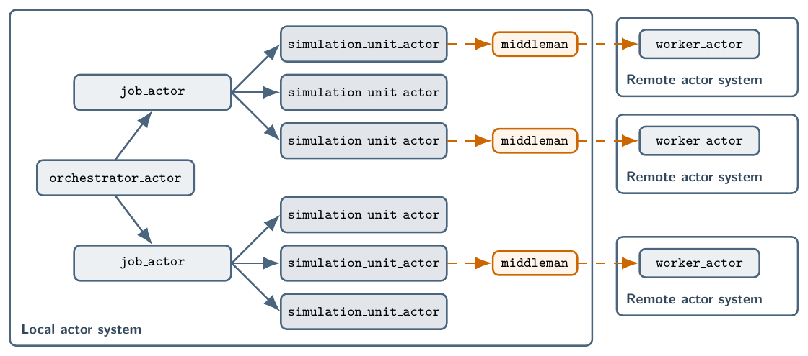
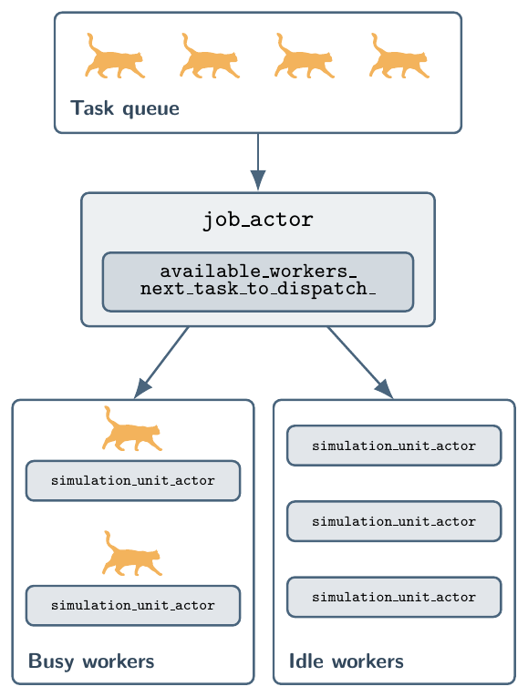

Architecture
============

Orchestration model
-------------------

MIAOW executes simulation workflows through an actor hierarchy inspired by `SUMMA-Actors <https://github.com/uofs-simlab/Summa-Actors>`_ (`Klenk and Spiteri, 2024 <https://doi.org/10.1007/s10586-024-04318-5>`_), as illustrated in the figure below. Each remote actor system shown here is a subprocess on the same host:

The five application actors use CAF-managed implementation classes: public ``miaow::Job`` and ``miaow::SimulationUnit``, and internal ``miaow::core::Orchestrator``, ``SubprocessRegistration``, and ``SubprocessWorker``. Each class contains its actor's state and methods, defines message handlers through ``make_behavior()``, and is spawned with ``caf::actor_from_state<Implementation>``.

An actor provides identity, a mailbox, scheduling, and lifecycle management. Its contained implementation object holds application data and handles operations. Names such as ``simulation_unit_actor`` identify actor roles or handles; ``SimulationUnit`` names the corresponding implementation class. The public ``miaow::TaskExecutor`` interface supplies task execution, and ``TaskExecutorRegistry`` stores the registrations selected by ``TaskExecutorId``. ``SimulationUnit`` owns a separate ``SubprocessState`` member for asynchronous child-process lifecycle management. Subprocess lifecycle callbacks run serially in that actor, so their captures refer to actor-owned state.

A typical workflow includes the following steps:

1. Caller prepares a ``Job`` with declared simulation units, initial tasks, and an optional controller, then calls ``Runtime::submit_job(std::move(job))``.
2. Runtime assigns a ``job_submission_id`` and sends the prepared job to ``orchestrator_actor``.
3. ``orchestrator_actor`` spawns one ``job_actor`` that adopts the prepared state and calls ``initialize(Job&)`` once. The controller may add units and tasks alongside caller-provided work.
4. The job selects the earliest queued task whose target unit is idle, subject to ``RuntimeOptions::max_concurrent_tasks_``. It activates that unit on first use and sends the task to its actor.
5. The unit constructs its selected ``TaskExecutor`` once and retains it across operations. Each task calls that executor and returns a ``TaskResult`` to the job actor.
6. The job records completed tasks and invokes ``JobController::callback(Job&, completed_tasks, failed_units)`` according to the controller policy. The controller appends work through ``Job::add_task()``; preparation and dispatch follow after the callback returns. Execution ends when no queued or active tasks remain and the controller adds no further work.
7. The job actor waits for remaining units to shut down, then calls ``JobController::finalize()`` once to collect structured job output. Completed ``TaskRecord`` values are sorted by ``TaskId`` and stored with this output in one ``JobRecord``.
8. Runtime fulfils the caller's ``JobHandle`` future.

Each ``JobController`` selects a ``TaskGenerationPolicy`` through its constructor:

- ``asynchronous`` (default): call ``callback()`` after an operation completes or a unit becomes unavailable.
- ``batch_synchronous``: call ``callback()`` when every task in the current batch has reported a result. Caller-provided tasks and tasks added during initialization form the first batch; tasks added by each callback form the next batch.

Both policies pass new task records in completion order through a borrowed ``std::span<const TaskRecord>``. Asynchronous callbacks receive an operation completion or the records affected by unit loss; batch callbacks receive the completed batch. A batch is complete when its queued tasks are settled and its active operations have finished.

The controller retains any history it needs between callbacks. It decides how to respond to reported operation failures and unavailable units.

Controller hooks run serially in the job actor. ``initialize(Job&)`` always runs once before the initial dispatch and may add tasks alongside caller-provided work. An empty job finalizes normally when initialization adds no tasks. Controllers can request job-level failure through ``Job::fail(reason)``; hook exceptions also propagate through ``JobHandle::get()`` and produce no final job record.

``UnitFailure`` identifies an unavailable unit by handle and diagnostic reason. Executor or subprocess startup failure, unexpected actor or child termination, and task timeout can make a unit unavailable. Its active and queued tasks receive failed records exactly once. An idle unit can fail without producing a task record.

The callback receives these records and the unit failure together. Asynchronous policy reports the loss promptly; batch policy waits for the current batch to finish. The default controller fails the job. A custom controller may continue other units, remove the failed unit, or explicitly construct a replacement. Recovery never reconstructs state or replays tasks automatically.

The following figure illustrates the task scheduling process managed by the ``job_actor`` in steps 4 through 6 of the above workflow, where the orange cat icons represent tasks and the worker groups contain simulation-unit actors. Each task is dispatched to its declared unit when that unit is idle:

Units activate when their first ready task is dispatched. Each ``SimulationUnit`` owns its own executor instance and retains it across operations. ``RuntimeOptions::max_concurrent_tasks_`` limits active operations, independently of unit count. Idle actors do not occupy CAF scheduler threads.

Simulation units
-----------------

``Job`` owns simulation units, initial tasks, and its controller before submission. ``add_unit(feature_id, executor_id)`` constructs a prepared ``SimulationUnit`` and returns its job-scoped ``SimulationUnitHandle``. The feature ID labels the scientific unit; the executor ID selects its factory. The unit actor is created when its first ready task is dispatched.

Each job receives a process-local ``JobCreationId`` at construction and retains it across moves. Unit handles store this identity as ``job_creation_id`` alongside their vector ``index``, so handles from different jobs remain distinct. Submission assigns a separate runtime-local ``JobSubmissionId``, stored as ``job_submission_id`` in the final job record and used to number the job's output directory.

.. code-block:: cpp

   miaow::Job job;
   const miaow::SimulationUnitHandle a = job.add_unit("A", counter_executor);
   const miaow::SimulationUnitHandle b = job.add_unit("B", counter_executor);
   job.add_task(a, "increment", 2);
   job.add_task(b, "increment", 1);
   job.add_task(a, "increment", 3);
   job.set_controller(std::make_unique<CounterController>(a, b));
   miaow::JobHandle result = runtime.submit_job(std::move(job));

``add_task(unit, operation, args...)`` stores the operation in ``Task::operation_`` and converts each trailing argument to a ``caf::config_value`` in ``Task::args_``. The executor interprets these values; completed ``TaskRecord`` values retain the operation and target handle.

Unit handles survive job moves and may be stored in a controller. Every task targets a unit in its owning job. Controllers can add units through ``job.add_unit(...)`` and append operations through ``job.add_task(...)`` during execution.

Each unit retains its executor until shutdown and runs one operation at a time in submission order. ``max_concurrent_tasks_`` limits occupied task slots across the job, independently of unit count. Tasks for busy units do not block ready tasks for other units.

``job.remove_unit(handle)`` closes a unit to new tasks and drains accepted operations before shutdown. Repeated removal is harmless, and expected shutdown is not a unit failure. Unit indices are never reused. Replacements for removing or failed units may reuse their feature labels but receive distinct handles. Job completion shuts down all remaining units and waits for cleanup before delivering its result.

Operations on a unit share its feature label, with unique task IDs in artifact stems such as ``A_task_0`` and ``A_task_2``. BMI executors create a fresh model for each task.

Task timing
-----------

``TaskRecord::dispatch_offset_from_job_start_`` stores the elapsed seconds from job start to task dispatch, measured using the same monotonic clock as ``run_time_``. Dispatch precedes the unit actor beginning execution.

``TaskRecord::unit_`` is required and retains the declared target's ``job_creation_id`` and ``index``, including for tasks that never dispatch. The index is the unit's position in the job's bindings and may exceed ``max_concurrent_tasks_ - 1``. A non-null dispatch offset identifies a dispatched task, independently of its scheduler thread or subprocess PID.

``TaskRecord::run_time_`` measures the interval from dispatch until the job actor records the result or timeout. It includes scheduling and communication overhead and any subprocess startup or cleanup. Adding it to the dispatch offset gives the time relative to job start when the terminal status was recorded.

Tasks that reach the job timeout before dispatch have a null dispatch offset and zero runtime. Dispatched tasks retain their dispatch offset and elapsed runtime up to the timeout. Unavailable dispatch offsets are ``std::nullopt`` (``null`` in JSON).

Structured task output
----------------------

``TaskResult::output_`` carries optional structured output as a ``caf::config_value``. It supports scalar values and recursively nested lists and dictionaries, and remains available through the completed ``TaskRecord`` values passed to ``JobController::callback()`` and retained by the final ``JobRecord``. Controllers are responsible for validating the structure and value types defined by their task executors. Large time series, grids, and model state should be written to files and referenced by ``TaskResult::artifact_paths_``.

When ``RuntimeOptions::output_root_`` is configured, each task's structured output (or a ``null`` value) is included in the ``job_record.json`` written when the job completes.

CAF uses MIAOW's ``inspect()`` functions to collect each job record's fields. nlohmann/json then writes the record to a JSON file. Saved records retain CAF's type annotations and duration strings, with enough digits to round-trip finite double values. Non-finite numerical values are written as JSON ``null``.

Structured job output
---------------------

``JobController::finalize()`` returns optional structured output as a ``caf::config_value``, with null as the default. Runtime retains the result in ``JobRecord::output_`` and includes it in ``job_record.json`` when output is enabled.

The job actor calls ``finalize()`` once when creating the final record, including for empty jobs and job timeouts. At a timeout, the controller can return its accumulated state; synthetic timeout records are not passed to ``callback()``. Finalization is serialized with task-generation calls and should return promptly. Controller errors and runtime shutdown produce no final record. Exceptions from controller hooks propagate through ``JobHandle::get()``.

.. warning::

   With CAF 1.1, task and job output must not contain null list elements or dictionary values: binary deserialization fails. Returning ``caf::config_value{}`` for the entire output is supported.

.. _task-execution:

Task execution
--------------

A unit's ``TaskExecutorId`` selects its registered executor. ``TaskExecutorRegistry::add<TaskExecutorType>(...)`` registers parent-process execution; ``TaskExecutorRegistry::add_subprocess(executable)`` registers a subprocess-backed executor. Each task selects the unit through ``Task::unit_``.

Completed task records retain the executor selection as ``task_executor_id``, derived from the unit binding. The registry ID identifies an implementation and its configuration; the unit handle identifies a particular job-scoped instance.

Every unit actor constructs one executor and calls ``execute(task)`` for each operation. Operation failures use failed ``TaskResult`` values. Subprocess executors delegate their response while actor-owned state starts or reuses the child and receives its result without blocking a parent scheduler thread. The child implements the ``Task`` to ``TaskResult`` contract through ``run_subprocess_worker()`` and does not receive the parent registry.

A subprocess task timeout terminates and reaps the child before reporting unit loss. A job timeout marks all unfinished tasks as failed and requests unit shutdown; it remains a hard deadline that controller policy cannot extend. Running in-process evaluations are not interrupted by either timeout; their actors shut down after ``execute()`` returns. Job delivery waits for shutdown, so cleanup or an uninterruptible native call may delay delivery beyond the configured deadline.

Each subprocess-backed unit starts its own child on first use and retains it between operations. Reported operation failures retain the child and its diagnostics.

Startup failure, child termination, and task timeout trigger cleanup and report unit loss. Removal and job completion also request child shutdown. Cleanup polls for process exit without blocking a parent scheduler thread; the unit quits only after its child is reaped.

.. _custom-subprocess-executables:

Custom subprocess executables
^^^^^^^^^^^^^^^^^^^^^^^^^^^^^

The following setup registers an executable, declares a unit, and appends one operation:

.. code-block:: cpp

   miaow::TaskExecutorRegistry registry;
   const miaow::TaskExecutorId custom_executor_id =
       registry.add_subprocess("/path/to/my_worker");

   miaow::Job job;
   const miaow::SimulationUnitHandle unit = job.add_unit("custom", custom_executor_id);
   job.add_task(unit, "run", "input");

The parent registry constructs a ``SubprocessTaskExecutor`` for each activated unit. The selected executable links against MIAOW and implements the task contract by supplying any synchronous callable that accepts ``const Task&`` and returns ``TaskResult``:

.. code-block:: cpp

   #include <miaow.hpp>

   miaow::TaskResult execute_task(const miaow::Task&) {
       return {miaow::TaskStatus::succeeded, "custom task completed"};
   }

   int main(int argc, char* argv[]) {
       return miaow::run_subprocess_worker(argc, argv, execute_task);
   }

The executable's ``main()`` must pass its supplied ``argc`` and ``argv`` to ``run_subprocess_worker()`` unchanged because MIAOW uses those arguments for parent registration. Custom configuration travels in ``Task`` rather than additional command-line arguments. The worker invokes the handler serially once per received task; a persistent subprocess may invoke the same handler object for multiple tasks. An exception from the handler becomes a failed ``TaskResult``.

Limitations
-----------

- Although subprocess execution is currently supported using remote actors, MIAOW does not currently support distributed-memory parallelism across multiple nodes. This is a planned feature for future releases.
- Microsoft Windows is not currently supported, and there are no immediate plans to support it. MIAOW has been tested on Linux and macOS, and future releases will continue to support these platforms.
