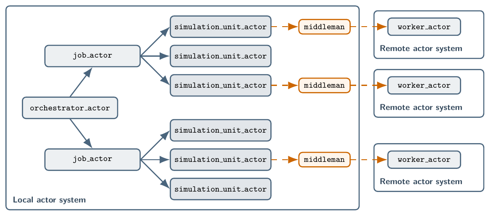
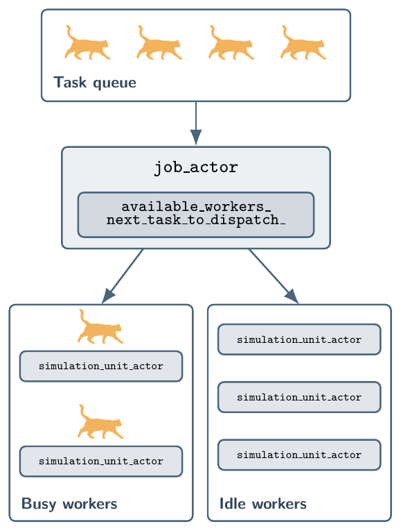

Architecture
============

Orchestration model
-------------------

MIAOW executes simulation workflows through an actor hierarchy inspired by `SUMMA-Actors <https://github.com/uofs-simlab/Summa-Actors>`_ (`Klenk and Spiteri, 2024 <https://doi.org/10.1007/s10586-024-04318-5>`_), as illustrated in the figure below:

A typical workflow includes the following steps:

1. Caller invokes ``Runtime::submit_job(task)``, ``Runtime::submit_job(tasks)``, or ``Runtime::submit_job(tasks, std::move(job_controller))``. In the third overload, ``job_controller`` has type ``std::unique_ptr<JobController>``, and ``Runtime`` takes ownership of the controller. The controller's role is to generate additional tasks according to its task generation policy, and it can inspect all completed task records to determine what new tasks to generate.
2. Runtime assigns a ``job_id`` and sends the tasks and job controller to ``orchestrator_actor``.
3. ``orchestrator_actor`` spawns one ``job_actor`` for that job. The job actor owns the controller and task vector and creates enough reusable ``simulation_unit_actor`` workers for the initial tasks, up to ``RuntimeOptions::max_workers_``.
4. The ``job_actor`` greedily dispatches tasks to available ``simulation_unit_actor`` workers.
5. Each worker resolves ``Task::simulation_unit_id_``, constructs a new ``SimulationUnit``, executes the task, and returns a ``TaskResult`` to the job actor.
6. After each task execution returns a successful or failed ``TaskResult``, the ``job_actor`` creates its ``TaskRecord``. When the controller's task generation policy permits, it passes all completed task records to its controller, appends tasks returned by the controller's ``generate_new_tasks()`` method to its task vector, and adds workers if needed. It then returns to step 4. This continues until no queued tasks remain to dispatch and no dispatched tasks are awaiting results, and the controller returns no new tasks.
7. Completed ``TaskRecord`` values are sorted by ``TaskId`` and stored in one ``JobRecord``.
8. Runtime fulfils the caller's ``JobHandle`` future.

``JobController`` uses ``TaskGenerationPolicy::asynchronous`` by default, calling ``generate_new_tasks()`` after each task reports a result. Alternatively, a derived controller can select synchronized batches by passing ``TaskGenerationPolicy::batch_synchronous`` to the ``JobController`` constructor. This policy calls ``generate_new_tasks()`` only when no queued tasks remain to dispatch and no dispatched tasks are awaiting results. The initial task vector forms the first batch, and each returned vector forms the next batch. Successful and failed results, including task timeouts, count toward batch completion; the controller decides how to handle failures. Both policies receive the full completed-record history in completion order. Tasks from earlier batches remain in the job's task vector.

The following figure illustrates the task scheduling process managed by the ``job_actor`` in steps 4 through 6 of the above workflow, where the orange cat icons represent tasks:

When the controller generates new tasks, the job actor counts entries in its task vector that do not yet have a corresponding completed task record and adds workers only if this count exceeds the existing worker count. Workers are not removed while the job is running, so the job retains the largest worker count that has been required at any point during the job, capped by ``RuntimeOptions::max_workers_``, until the job completes or shuts down. Idle ``simulation_unit_actor`` workers do not occupy CAF scheduler threads, so retaining them does not reduce scheduler capacity.

Structured task output
----------------------

``TaskResult::output_`` carries optional structured output as a ``caf::config_value``. It supports scalar values and recursively nested lists and dictionaries, and remains available through the completed ``TaskRecord`` values passed to ``JobController::generate_new_tasks()`` and retained by the final ``JobRecord``. Controllers are responsible for validating the structure and value types defined by their simulation units. Large time series, grids, and model state should be written to files and referenced by ``TaskResult::artifact_paths_``.

When ``RuntimeOptions::output_root_`` is configured, each task's structured output (or a ``null`` value) is included in the ``job_record.json`` written when the job completes.

.. _simulation-unit-execution:

Simulation unit execution
-------------------------

The ``Task::simulation_unit_id_`` field selects the ``SimulationUnit`` implementation that 
executes the task. ``SimulationUnitRegistry::add<SimulationUnitType>(...)`` registers a unit constructed and executed in the parent process, while ``SimulationUnitRegistry::add_subprocess(executable, lifetime)`` registers an internal ``SimulationUnit`` implementation that delegates each task to the supplied ``executable``.

Every ``simulation_unit_actor`` constructs the selected ``SimulationUnit`` and calls ``execute(task)``. In-process units registered using ``SimulationUnitRegistry::add<SimulationUnitType>(...)`` return an immediate ``TaskResult`` or CAF error. A subprocess unit returns a delegated CAF response while its actor-owned state starts or reuses the subprocess, sends the serialized ``Task``, receives ``TaskResult``, and completes required cleanup without blocking a parent scheduler thread. The child process implements the ``Task`` to ``TaskResult`` contract through ``run_subprocess_worker()`` and does not receive the parent registry.

The ``SubprocessLifetime`` argument to ``add_subprocess(...)`` controls whether the child process is started and stopped for each task or retained for reuse across multiple tasks.
``SubprocessLifetime::single_task`` starts one child for a task and stops and reaps it before delivering the result. ``SubprocessLifetime::persistent`` retains a child only after a successful task. An idle persistent child remains alive and retains its process resources, but MIAOW does not reserve a dedicated CPU core for it. The same idle ``simulation_unit_actor`` reuses that child only when the next task selects a persistent registration with exactly the same executable string and the child actor remains available. A failure, timeout, single-task registration, different executable, child termination, or worker shutdown prevents reuse. Failures and task timeouts preserve subprocess diagnostics and stop and reap the child before completing the delegated response.

.. _custom-subprocess-executables:

Custom subprocess executables
^^^^^^^^^^^^^^^^^^^^^^^^^^^^^

The following setup registers an exact executable path and uses the returned ``SimulationUnitId`` when constructing a task:

.. code-block:: cpp

   miaow::SimulationUnitRegistry registry;
   const miaow::SimulationUnitId custom_unit =
       registry.add_subprocess("/path/to/my_worker",
                               miaow::SubprocessLifetime::persistent);

   const miaow::Task task{custom_unit, "input"};

The parent registry supplies the polymorphic ``SubprocessSimulationUnit``. The selected executable links against MIAOW and implements the task contract by supplying any synchronous callable that accepts ``const Task&`` and returns ``TaskResult``:

.. code-block:: cpp

   #include <miaow.hpp>

   miaow::TaskResult execute_task(const miaow::Task&) {
       return {miaow::TaskStatus::succeeded, "custom task completed"};
   }

   int main(int argc, char* argv[]) {
       return miaow::run_subprocess_worker(argc, argv, execute_task);
   }

The executable's ``main()`` must pass its supplied ``argc`` and ``argv`` to ``run_subprocess_worker()`` unchanged because MIAOW uses those arguments for parent registration. Custom configuration travels in ``Task`` rather than additional command-line arguments. The worker invokes the handler serially once per received task; a persistent subprocess may invoke the same handler object for multiple tasks. An exception from the handler becomes a failed ``TaskResult``.

Limitations
-----------

- Although subprocess execution is currently supported using remote actors, MIAOW does not currently support distributed-memory parallelism across multiple nodes. This is a planned feature for future releases.
- Microsoft Windows is not currently supported, and there are no immediate plans to support it. MIAOW has been tested on Linux and macOS, and future releases will continue to support these platforms.
